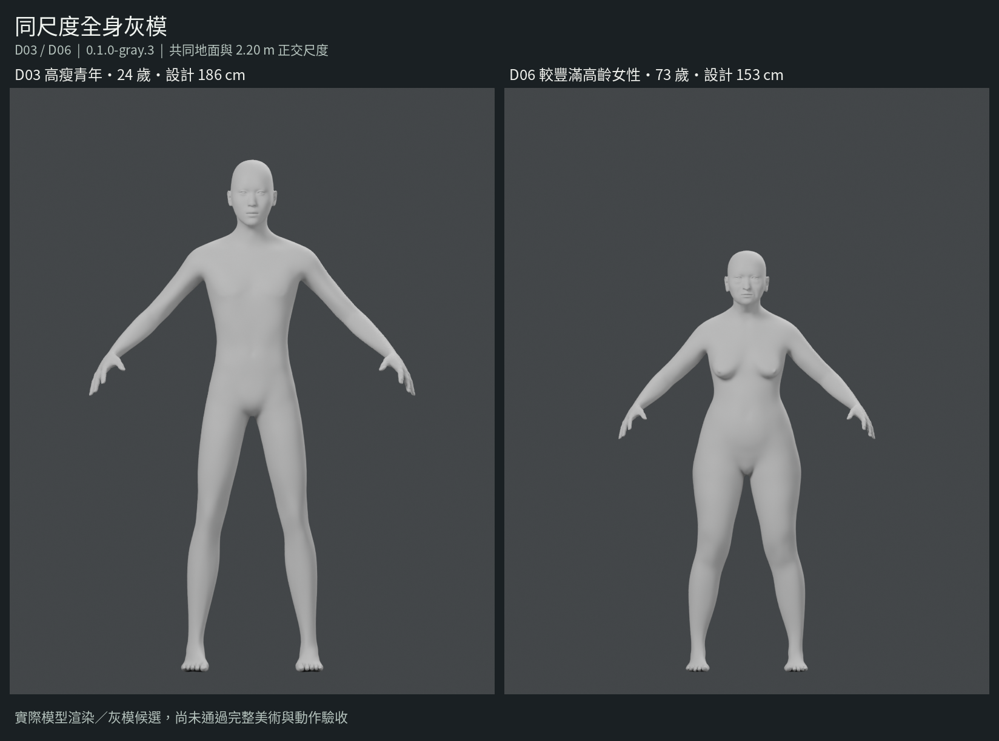
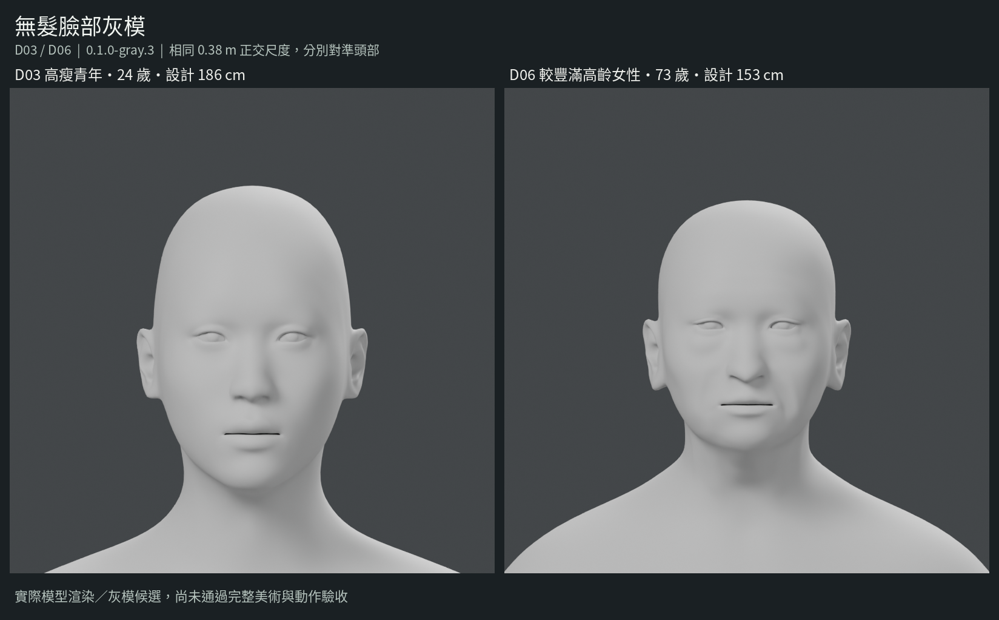
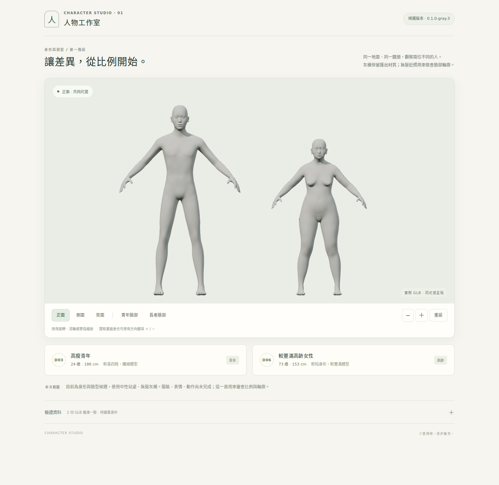

# D03／D06 灰模實際交付紀錄

版本 **`0.1.0-gray.3`**，階段 **`01-gray-identity`**，日期 **2026-10-31**。目前交付的是可操作、可編輯、可重建的兩位灰模候選；**`art_approved: false`、`game_ready: false`**。本紀錄不將結構檢查或 CI 成功當成美術驗收。

程式與角色設定固定在 [`747b5d995028beb01477a7ef2b09ae667f8990d5`](https://github.com/aitest-ai/3dcodeverse-lab/tree/747b5d995028beb01477a7ef2b09ae667f8990d5)，位於獨立分支 `feat/diverse-character-studio`、[Draft PR #50](https://github.com/aitest-ai/3dcodeverse-lab/pull/50)。既有角色及其他分支未被合併或覆寫。來源承接與 V110／V111 界線另見 [採用紀錄](CHARACTER_STUDIO_ADOPTION.md)。

## 1. 實際模型圖片

以下圖來自 **本版 GLB 匯出後，刪除原場景角色，再重新載入 GLB 的 Cycles CPU 渲染**。不是概念圖。原始每角度 PNG、相機設定及圖片 SHA-256 隨模型證據包交付。

全身兩圖使用相同 2.20 m 正交尺度與共同地面；沒有將兩人各自縮放成相同高度。臉部兩圖均為 0.38 m 正交尺度，只分別對準頭部。比較圖逐張貼入原始 800 px 圖片，未個別縮放或修圖。

每位另外交付側面、背面、臉部 35 度與臉部側面。瀏覽器畫面使用同一份 GLB、保留匯入材質與 `scale = [1,1,1]`，只作左右及貼地平移：

## 2. 身形與身份差異：已實作及尚未成立的部分

| 項目 | D03 高瘦青年 | D06 較豐滿高齡女性 |
|---|---:|---:|
| 虛構角色年齡設計目標 | 24 歲 | 73 歲 |
| 原生表面設計身高 | 1.860 m | 1.530 m |
| 細分／匯出表面實測高度 | 1.857735 m | 1.527769 m |
| 肩關節中心距 | 0.369303 m | 0.295526 m |
| 髖關節中心距 | 0.216398 m | 0.200567 m |
| 大腿／小腿骨長 | 0.506241／0.441573 m | 0.357991／0.363919 m |
| 前臂／上臂骨長比 | 0.995343 | 0.943511 |
| 腿骨鏈／細分表面高度 | 0.510198 | 0.472526 |
| 頭臉方向 | 較長橢圓臉、窄下顎 | 較短寬臉、不同鼻顎與頰部體積 |

關節中心距不是皮膚或衣服的外寬。細分後表面比原生設計高度約少 2.2 mm，兩種量測均保留；檢視器使用實測值。兩人先各自套用 macro 與局部身體／臉部 target、適配骨架及原生眼睛，最後才作米制校準，不以全身縮放代替身份建模。

冷讀母檔的比較使用相同、依序對應的原生拓樸。即使容許最佳等比縮放、旋轉及平移，全身仍有 **24.809 mm RMS／100.152 mm 最大**殘差；頭部共同區域有 **4.249 mm RMS／12.362 mm 最大**殘差。頭部區域含頭顱及耳朵，並非純臉部測量。這些數字只證明兩者不是等比幾何副本；不證明自然度、年齡辨識或美術成功。完整方法、座標、母檔雜湊與比值見交付包的 `comparison.json`。

### 仍須優先修正的造型

| 缺陷／限制 | 本輪觀察與下一個可核對關卡 |
|---|---|
| D06 高齡辨識仍不足 | 已調整頭型、鼻顎、頰部體積與年齡 target，但實圖仍可能讀為一般成熟成人，不能宣稱已自然呈現 73 歲。繼續審查骨相、軟組織與姿態，之後再共同檢查皮膚及髮型；不只靠白髮或皺紋。 |
| 嘴縫／口角偏直硬 | 第三輪已微調唇峰與口角，實圖仍有模型預設感。先處理閉口輪廓與唇部接觸，再做笑容、說話及混合表情。 |
| 眼球／眼瞼接界 | 近照可見較硬暗邊與眼角縫隙感。圖片本身不能判定是否穿模；須再做局部幾何、閉眼與轉眼檢查。 |
| D06 後枕至頸部轉折 | 第三輪調整頸後體積，但側面仍有較強轉折及陰影帶，沒有標成已解除。 |
| 手足、骨點與姿態 | 現有細節仍偏平滑、通用；目前是參考 A 姿態，沒有高齡站姿或動作自然度驗收。 |

本版保留前兩輪本地候選，對外交付及 registry 固定第三輪。下一個候選須新增版本，不能默默改寫本版 GLB 或以服裝、髮型遮掉上述問題。

## 3. 驗證結果與適用範圍

| 層級 | 實際執行 | 結果／界線 |
|---|---|---|
| GLB 二進位結構 | 解碼實際 BIN；檢查 stride、sparse、normalized、索引、權重及 skin | 兩位均 0 errors、0 warnings；另通過既有 manifest validator。不是完整 Khronos Validator 或美術判定。 |
| Blender 匯出與重載 | Blender 5.2.3 LTS；刪掉場景角色後重新匯入交付 GLB | 每位 6 張實際渲染；重載 bounds 最大差 D03 0.000000715 m、D06 0.000000238 m。 |
| 母檔冷讀與貼圖 | clean 母檔重新開啟，核對 packed bytes、尺寸與解碼結果 | 兩位 `brown_eye.png` 原始 1024×1024、1,048,576 pixels 均可解碼，SHA 相同，未降成 512。來源另保留 256×256 的原始 legacy litsphere，沒有升／降採樣冒充新來源。 |
| 獨立 CI 重建 | [Actions 41199840750](https://github.com/aitest-ai/3dcodeverse-lab/actions/runs/41199840750)，來源 commit `747b5d9` | `completed / success`；兩位生成、重載、冷讀、貼圖門檻、結構檢查、幾何比較及可執行 viewer 打包均完成。CI 不包含本機瀏覽器美術驗收。 |
| 實際瀏覽器 | Chromium 151.0.7922.34、Three.js 0.187.0、SwiftShader WebGL 2 | 同版 GLB 的 SHA、尺度、正側背／臉部控制、拖曳、錯誤雜湊攔截及同版重試通過；無 page errors。仍屬軟體渲染環境。 |
| 手機寬度版面 | 桌面 Chromium 的 390 px viewport | 無水平溢出；不是 Android 真機。 |
| 完整地圖／Android | 未執行 | 不記作通過，不由軟體 GL、骨數或面數推定裝置能力。 |

結構檢查的 0 warnings 不代表建模日誌沒有警告。兩位的細分表面都有部分點超過 4 個 influence，glTF exporter 在輸出時保留最高 4 個並正規化；完整訊息已保留在各自的 `build.log`。靜態重載沒有發現 bounds 差異問題，但尚未證明關節動態變形自然，須在動作階段逐位檢查腋下、肘、腰臀、膝與手足。

### 瀏覽器持續量測

實際 canvas 1182×650、DPR 1、2048 陰影，保留匯入材質。可見期間約 33.15 秒，排除 3 秒暖機後取得 194 個 frame-interval samples：p50 **150 ms**、p95 **300 ms**、最大 **449.9 ms**、平均 **140.888 ms**。本輪測試期間沒有同時進行 Blender 渲染；軟體 renderer 及共享運算環境仍會影響數據。

量測是瀏覽器 frame interval，不是 GPU timer query。原始序列、renderer、解析度、採樣規則與場景資料保留在 `browser/desktop_measurements.json`。資料沒有被轉換成 Android 能力結論，也沒有觸發低品質替身或自動 LOD。

前一輪曾因多個軟體 GL 場景與 Blender 同時運作而 `Target crashed`，該次結果未當作通過。第三輪依序關閉正向場景再跑負向測試，取得完整 `ACTUAL_WEBGL_REVIEW_COMPLETED`。`report.json` 及結構 inspector 的「未測瀏覽器」是各自產生時點／工具範圍；後續瀏覽器證據由獨立報告與 `delivery_provenance.json` 補充，不改寫先前記錄。

## 4. 實際模型內容及版本鎖

每位 GLB 均為 2 meshes／2 primitives、1 skin、53 個本適配器實際 joint，匯出 POSITION 記錄共 72,061、三角形 109,064。這是觀測資料，不是角色庫統一限制。灰模 GLB 沒有嵌入彩色影像；原始眼睛材質及貼圖保存在母檔與素材包。

| 檔案 | bytes | SHA-256 |
|---|---:|---|
| `d03.glb` | 5,063,876 | `66ecd26156fac135aeae35d5d9770d0757bae3e9678df413cb4cdc999cbb4c57` |
| `d06.glb` | 5,064,564 | `4fca95db9b52e40d435dc25e26b574dbedfe63514240d156ebadf5cefa7bb746` |
| `d03.blend` | 1,482,939 | `722b5d746c1e97db767b1844db87b62b21bab883df55caa6937129a7373c6d89` |
| `d06.blend` | 1,485,442 | `5ab0c40a52330437b22809777f7a35f9b034236c64cbfd906d31196e06f5d952` |

兩份參數母檔也完整保留：`d03_parametric.blend`、`d06_parametric.blend`，並以各自獨立的 Blender 背景程序冷讀核對。兩份均保留 19,158 頂點及完整 helper，D03／D06 各有 45／74 個可編輯形態 target（不含 Basis），均為本地可編輯資料；這些不是 runtime 表情鍵。原始 1024×1024 packed 眼睛影像完整解碼、所有像素有限，母檔讀前後 SHA 不變。詳見 [參數母檔冷讀證據](character-studio/0.1.0-gray.3/parametric_cold_read.json)。全部檔案及 ZIP 的完整 hash、byte 大小與來源見 [delivery_index.json](../assets/characters/studio/delivery_index.json)。

本輪實際 build script SHA-256 為 `4791ad6c5b8c61885a77c17766b8f63f65bfd3754e2e77f096c7c533f4ee0f86`，profiles SHA-256 為 `893b859fa382d74e2d39bbbfcfd2c0faeeba4ed9ccdebe4fb17967c2d1163927`。本地渲染時尚在工作樹，報告保留當時標籤 `working-tree-gray3-after-a339ee6d`；後續逐位元組核對這兩檔與已提交的 `747b5d9` 相同。CI 同樣使用該提交。不同機器產生的 `.blend` metadata／路徑及渲染浮點結果可能不同，不宣稱跨機器 ZIP 位元組必然相同。

## 5. 分包、保存與可重現入口

本次持久分包以精確檔名與 hash 辨識，隨交付訊息提供下載入口；沒有建立公開 Release，也沒有改專案可見性。

| 分包 | 內容 |
|---|---|
| `character-studio_0.1.0-gray.3_models-evidence.zip` | 兩個 GLB、12 張各角度模型原圖、3 張比較圖、實際瀏覽器截圖與量測、結構／幾何／來源證據、授權副本、包內 SHA256SUMS。 |
| `character-studio_0.1.0-gray.3_blender-masters.zip` | 兩位各一份完整參數母檔及 clean 母檔，共 4 份 `.blend`；原尺寸貼圖、骨架語意、實際 profile／量測與來源紀錄。 |
| `character-studio_0.1.0-gray.3_original-sources.zip` | 固定 MPFB 原始 ZIP、官方眼睛 MHCLO／OBJ／材質與原圖、完整 Three.js 原始套件、比較圖字型及授權原文／來源 manifest。沒有把 V110 的缺陷衣服包進新人物當作成品。 |

可執行原始碼持續保存在此 Git 分支；[主要交接文件](CHARACTER_STUDIO.md#3-從原始碼重建) 提供完整重建及啟動命令。另提供本地打包的可執行 viewer ZIP，且 CI artifact 內的 `review_app/` 可直接以 `python3 -m http.server` 服務。檢視器沒有 CDN 依賴；首次重建工具鏈才需要下載官方鎖定來源。

[CI artifact `13042541079`](https://github.com/aitest-ai/3dcodeverse-lab/actions/runs/41199840750/artifacts/13042541079) 為 30,943,491 bytes，API digest `sha256:2781e3f39b13119864a6b62b719cdea0bdb03cfc18041acbc6a8c2548f828a29`，預定 **2026-11-30 12:13:17 UTC** 到期。它包含獨立 CI 產物，並非本地交付 ZIP 的另一檔名，hash 不可混用。持久母檔與原始素材使用上述分包，不依賴 30 天 artifact 留存。

## 6. 尚未交付及接續順序

本版 **0 段動畫、0 個 runtime 表情鍵**。衣服、鞋、髮、皮膚材質、牙齒／舌頭適配、待機、走路、轉身、坐下與起身、指定遊戲地圖及 Android 真機仍未完成。A 姿態及可旋轉檢視器不是動畫片段。

先修第二節的灰模自然度問題，保留新版本實際比較圖；再逐身形適配服裝／鞋、表情與上述五類動作。胸口、領口、腋下、腰臀、膝部及袖口同時檢查輪廓、接縫、陰影與穿模，不能只憑零錯誤或零碰撞過關。原始人體保留，不能以大面積刪除人體遮掉不合身。

V111 修胸口來源尚未取得；需要確切分支／commit、修正母檔、對應 GLB／互動包、素材差異及驗收證據，實際檔名未知，不假造檔名。V110 的胸口仍是已知問題，不能作美術通過標準；V103 不作替代。騎車與騎馬按使用者要求留待後續，使用不同接觸點、獨立動作與各自驗收。
