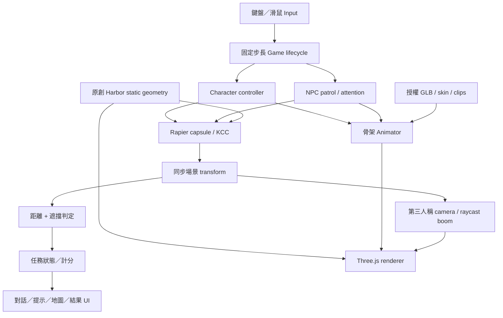

# 技術決策與模組邊界

本版選擇 TypeScript + Three.js + Rapier + Vite，角色由 Blender 匯出 glTF 2.0 GLB。這是為了直接在標準網頁載入、以可讀程式模組跨專案使用；不是對各引擎做過實測效能排名。

| 選項 | 網頁與維護 | 角色與動畫 | 物理 | 此階段判斷 |
|---|---|---|---|---|
| Three.js | 原生網頁、TypeScript 易測試；須自行組裝遊戲系統 | GLTFLoader、SkeletonUtils.clone、AnimationMixer；需自行控制狀態與 IK | 外接 Rapier | 本版採用，模組可拆分 |
| Babylon.js | 網頁原生，內建更多場景工具 | 支援 glTF 與動畫；整體引擎功能較完整 | 可整合物理引擎 | 有效替代方案，未做平行實作或 benchmark |
| Godot | 可匯出網頁；需考慮匯出版本與瀏覽器限制 | 內建動畫樹、編輯器與導覽工具 | 內建物理 | 適合更依賴編輯器的團隊，未測本專案 |
| Unity WebGL | 編輯器成熟，網頁建置負載與版本管理較重 | Animator、Humanoid 與既有資產生態成熟 | 內建物理 | 有大量 Unity 專案資產時再評估，未測本專案 |

## 已實作的模組

- `src/core/`：生命週期、60 Hz 固定物理步長、輸入、可見性切換。每畫面最大追趕 80 ms，避免背景頁面回來大幅跳躍；低 FPS 時會造成遊戲時間慢於真實時間，本版測量報告明示此限制。
- `src/physics/`：靜態碰撞、重力、膠囊 KCC、自動跨小階與地面吸附。NPC 與玩家均使用 kinematic；目前移動查詢排除其他 kinematic，因此 NPC 彼此與玩家沒有實體阻擋，只有距離與視線互動。
- `src/characters/`：GLB 驗證載入、SkeletonUtils 複製獨立骨架、加減速、面向與同步；不修改骨骼來偽裝 locomotion。
- `src/animation/`：具名 clip、0.22 s crossfade、依速度縮放 Walk/Run 時間。轉向 clip 是獨立製作的步態候選；行走朝向另由 controller 處理。沒有 Foot IK、motion matching 或經量測的步頻校準。
- `src/camera/`：目標平滑、拖曳旋轉、滾輪距離、對實體場景的 raycast boom 避障。
- `src/npc/`：固定路點、等待、接近轉向、對話、短暫慶祝。沒有 navmesh，新增場景必須審查巡邏路線。
- `src/interaction/`：2.65 m 範圍與環境遮擋。
- `src/gameplay/`：available → collecting → deliver → complete；重複收集、交付、提前交付不加分。
- `src/world/`：原創街區建築、海面、街具、燈籠、樹木；靜態幾何依材質合批，碰撞與相機遮擋保持獨立。
- `src/ui/`：完整 DOM UI、收集提示、對話選項、任務結果、即時地圖、畫質切換、載入及重試。
- `src/viewer.ts`：獨立角色工房，七段動畫選擇、四個鏡位與臉部 morph 滑桿。

## 此版範圍與擴充接口

一個場景、三個共享骨架接口的角色、兩位 NPC、一個完整任務。尚無存檔、串流世界、場景切換、碰撞烘焙、觸控移動、音訊、LOD、自動解析度調節、貼圖 KTX2 壓縮或 GPU 實機效能認證。省電模式降低像素比例並關閉陰影；標準模式開啟陰影。貼圖已縮至最大 1024，但 GLB 仍約 11.5 MB，可再去重及壓縮。
